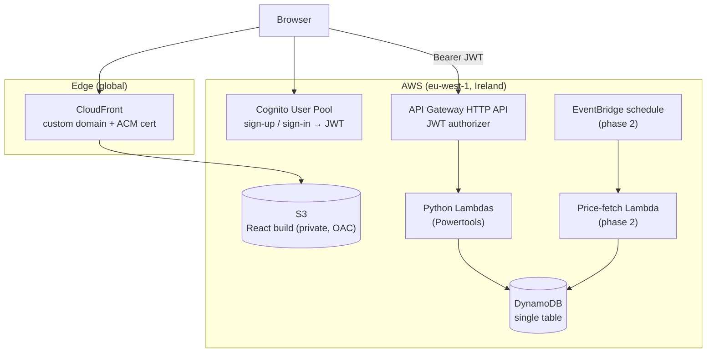

# pensionTracker — Roadmap

This is a living planning document. Edit it directly at any time — add, remove,
reorder, or tick off items — and future work (by you or by Claude) should pick up
your edits automatically by reading this file before starting.

## Overview

A learning project for **AWS serverless** (Python Lambdas) and **infrastructure as
code** (AWS CDK in Python → CloudFormation), built incrementally — one checklist
item at a time, not all at once.

It is also a **portfolio piece**: a real, publicly hosted app that a prospective
employer can sign up to, log in to, and use to track their own pension portfolio.

## Domain & Purpose

**UK Pension Tracker.** Each user tracks their own pensions, in GBP:

- **Pots** — workplace (defined contribution), SIPP, personal pension, and a
  State Pension forecast.
- **Contributions** — money paid in over time, including 25% basic-rate tax
  relief added at source for personal pensions and SIPPs.
- **Valuations** — periodic snapshots of each pot's value, entered manually.
- **Projections** — estimated value at retirement age, from an assumed growth
  rate plus ongoing contributions.

Built in two phases:

1. Pots, contributions and **manual** valuations, with charts and projections.
2. **Fund-level holdings** — each pot holds funds/units, valued from daily fund
   prices (manual entry first, then a scheduled price-fetch Lambda).

This is a demo: users are encouraged to use fictional figures, not real
financial data (see Portfolio polish).

## Architecture

### Request flow (example: list my pots)

1. The browser loads the React app from CloudFront (files live in a private S3
   bucket that only CloudFront can read).
2. The user signs in via Cognito and receives a JWT.
3. The app calls `GET /pots` on the HTTP API with `Authorization: Bearer <jwt>`.
4. API Gateway's JWT authorizer verifies the token against the Cognito User Pool
   *before* any Lambda runs — invalid/missing tokens get a 401.
5. The Lambda reads the caller's identity from the verified token's `sub` claim
   (never from the request body/path) and queries DynamoDB for `PK = USER#`.

**Data isolation rule:** a user's ID comes *only* from the verified JWT. Every
DynamoDB key a user can touch is prefixed `USER#`, so one user can never
address another's data.

## Data model (single-table DynamoDB)

| PK | SK | Item |
|---|---|---|
| `USER#` | `PROFILE` | name, date of birth, target retirement age |
| `USER#` | `POT#<id>` | pot name, type, provider |
| `USER#` | `POT#<id>#VAL#<date>` | valuation |
| `USER#` | `POT#<id>#CON#<date>` | contribution (gross / net / tax relief) |
| `FUND#<isin>` | `PRICE#<date>` | *(phase 2)* daily fund price |
| `USER#` | `POT#<id>#HOLD#<isin>` | *(phase 2)* units held |

## Environments & cost

- **dev** and **prod** stacks in a single AWS account, separated by stage name
  (option to split into separate accounts under AWS Organizations later — see
  Stretch).
- Region **eu-west-1** (Ireland) rather than London: a few percent cheaper
  for most services, gets new features first, and the extra ~10 ms latency from
  the UK is hidden by CloudFront. The CloudFront certificate lives in
  **us-east-1** because CloudFront requires it there.
- Everything chosen to sit within or close to the free tier. Known fixed costs:
  Route 53 hosted zone ~$0.50/month, domain registration (yearly).
- An AWS Budgets alert is part of the infrastructure (emails at 80% actual and
  100% forecast of a small monthly budget).
- dev can be torn down at any time with `cdk destroy`.

## Interface

- Public website at the custom domain (static hello-world page first, then the
  React app).
- REST API (HTTP API) for the app's data.
- AWS console + `cdk synth` output to inspect what's deployed.

## Working method

- Work through the checklist **one item at a time**. Finish and verify one before
  starting the next.
- Tick items off as `- [x]` when done; a short note (date, brief detail) is
  optional but helpful.
- This doc is editable — reorder, add, cut, or split items whenever priorities
  change.
- An item isn't done just because it works — it also has to clear the
  **Definition of Done** below before being ticked off.
- Do not commit or push automatically when a task completes — leave changes
  uncommitted so they can be reviewed first. Even when "commit" is mentioned in
  a message that also starts new work, show the diff/summary first.
- Ask before anything that costs money or changes AWS (`cdk deploy`,
  `cdk destroy`, domain purchases).

## Definition of Done

A standing bar every checklist item is measured against:

- **Tests** — ≥90% line coverage for `backend/` and `infra/`
  (pytest-cov `--cov-fail-under=90`, so the test run fails below it); ≥80% for
  `frontend/` (Vitest). Lambda tests use `moto` for AWS services; infra tests use
  CDK `assertions` against the synthesized templates.
- **Security** —
  - no secrets in git (`.gitignore` covers common patterns; config via CDK
    context, env vars or SSM Parameter Store);
  - least-privilege IAM (CDK `grant_*` methods, no wildcard actions/resources);
  - `cdk-nag` (AwsSolutions pack) passes on every synth, and any suppression is
    justified in code;
  - user identity only ever taken from the verified JWT;
  - API error responses never leak stack traces or internal detail;
  - `pip-audit` / `npm audit` clean;
  - S3 buckets private (CloudFront Origin Access Control only); HTTPS only.
- **Cost** — every new AWS resource is checked against the free tier and its
  cost noted in this plan (Environments & cost).
- **Documentation** — every module, class and public function gets a docstring
  explaining what it does and *why*; non-trivial logic gets inline comments
  walking through the reasoning. This project is explicitly for learning, so
  comments favour being thorough over minimal — the usual "avoid
  over-commenting" default is deliberately relaxed here, project-wide.

## Roadmap checklist

### Milestone 1: "Hello world" at a custom domain
- [x] AWS account hardening: root user MFA; IAM Identity Center enabled (eu-west-1) with user `john` + `AdministratorAccess` permission set — documented in `docs/aws-setup.md`
- [x] Local tooling: AWS CLI v2, `uv`, CDK CLI installed; `aws configure sso` profile `pensiontracker` working (`aws sts get-caller-identity`)
- [x] Register the domain in Route 53 (hosted zone auto-created); set `domainName` in `infra/cdk.json`
- [x] Repo scaffolding: `git init`, `.gitignore`, `README.md`, `CLAUDE.md`, this plan, `docs/how-it-works.md`, `docs/aws-setup.md`
- [x] `infra/` CDK Python app: `CertificateStack` (us-east-1, DNS-validated ACM cert), `SiteStack` (private S3 + CloudFront OAC + Route 53 alias records + `BucketDeployment` of `infra/site/`), `BudgetStack` (monthly budget + email alerts); cdk-nag applied; tests ≥90% coverage
- [x] `cdk bootstrap` eu-west-1 + us-east-1; walk through `cdk synth` output; `cdk diff`; `cdk deploy --all`
- [x] Verify: `https://<domain>` and `https://www.<domain>` return the hello page with a valid certificate; `http://` redirects to `https://`; direct S3 access is denied; budget alert subscription email received

### Foundations (backend)
- [ ] `backend/` uv project: ruff, mypy, pytest + coverage gate, `moto`
- [ ] Split dev vs prod: stage-aware stack names in `infra/app.py` (prod on the apex domain, dev on `dev.<domain>`)

### First Lambda end-to-end
- [ ] `GET /health` Python Lambda behind an HTTP API (at `api.<domain>` or under the CloudFront distribution), deployed to dev — inspect the synthesized template, curl it, find its logs in CloudWatch

### Authentication
- [ ] Cognito User Pool + app client in CDK (email sign-up, password policy)
- [ ] JWT authorizer on the HTTP API; `GET /me` returns the caller's `sub` — verify a request without a token gets 401

### Pots
- [ ] DynamoDB table in CDK (on-demand, point-in-time recovery)
- [ ] Pots CRUD Lambdas with Powertools (logging, validation, consistent error responses)
- [ ] Tests proving user A can never read/modify user B's pots

### Frontend
- [ ] Vite + React + TypeScript scaffold in `frontend/`; replace the hello page with the React build in `SiteStack`
- [ ] Cognito sign-up / sign-in (Amplify Auth library)
- [ ] Pots list + create/edit form against the API

### Contributions & valuations
- [ ] API endpoints for contributions and valuations
- [ ] UI to record them; chart of value over time per pot and in total (Recharts)

### Projections
- [ ] Retirement projection: assumed growth rate, ongoing contributions, basic-rate tax relief, State Pension forecast input

### CI/CD (GitHub Actions)
- [ ] GitHub repo; OIDC identity provider + deploy role in CDK (no long-lived AWS keys)
- [ ] `ci.yml` on PRs: ruff, mypy, pytest + coverage, Vitest, `cdk synth` + cdk-nag, `pip-audit`, `npm audit`
- [ ] `deploy.yml`: deploy dev on merge to `main`; deploy prod on manual approval / tag

### Phase 2: fund holdings
- [ ] Funds + holdings per pot; manual price entry; pot value computed from holdings
- [ ] Provider interface for fund prices (one adapter per data source); API key in SSM Parameter Store (SecureString)
- [ ] Scheduled price-fetch Lambda (EventBridge, daily end-of-day) caching prices in DynamoDB — choose a provider (e.g. Alpha Vantage, EODHD, Twelve Data) after checking UK fund coverage and licensing for display to other users

### Portfolio polish
- [ ] Demo account with fictional data
- [ ] Architecture diagram + screenshots in the README
- [ ] Privacy note: demo app, don't enter real financial data

### Stretch / later
- [ ] CloudWatch alarms + dashboards; X-Ray tracing
- [ ] AWS WAF on CloudFront / API
- [ ] CloudFront + S3 access logging
- [ ] MFA in Cognito
- [ ] GDPR-style data export + account deletion
- [ ] End-to-end tests (Playwright)
- [ ] Separate AWS account for prod (AWS Organizations)

## Current State

- Planning complete. Local tooling installed (AWS CLI v2 in `~/.local/bin`,
  uv, CDK CLI).
- AWS account set up: root MFA, IAM Identity Center (single-Region instance,
  eu-west-1) with user `john` + `AdministratorAccess` (4-hour sessions). The
  `pensiontracker` SSO profile works (`aws sts get-caller-identity` returns the
  `AWSReservedSSO_AdministratorAccess` role). Declined the AWS CLI's offer to
  configure AWS skills / MCP server for AI agents, so AWS actions stay as visible,
  approvable shell commands.
- Domain `pensiontrackerapp.com` registered in Route 53 and verified; set as
  `domainName` in `infra/cdk.json`.
- Repo initialised and pushed to GitHub (public:
  https://github.com/jp5k/pensionTracker), with commits using the GitHub
  noreply email (set in this repo's local git config). Docs scaffolded.
- CDK bootstrapped in eu-west-1 and us-east-1. **All three stacks deployed**:
  `PensionTracker-Certificate` and `PensionTracker-Site` are CREATE_COMPLETE;
  `PensionTracker-Budget` shows UPDATE_ROLLBACK_COMPLETE (healthy). An update
  with a typo'd `alertEmail` was rejected by Budgets and rolled back to the
  original, working budget; the redeploy left it unchanged, so the status stays.
- Cost guardrails: $10/month budget (80% actual, 100% forecast alerts); Free Tier
  alerts and Cost Anomaly Detection (Default-Services-Monitor) set up in the console.
- `alertEmail` is now shape-checked at synth (`EMAIL_PATTERN` in
  `app_builder.py`) so typos fail before deploying; mypy now excludes `cdk.out/`.
  `uv run pytest`: 20 tests pass at 100% coverage; ruff and mypy (strict) clean.
- **Milestone 1 complete.** Verified: `https://pensiontrackerapp.com` and
  `https://www.…` return 200 with a valid ACM certificate (both names in the SAN,
  expires May 2027, auto-renewed by ACM); `http://` returns 301 → `https://`;
  direct S3 URLs return 403; the budget's alerts (80% actual, 100% forecast) go to
  John's email.
- **Next session:** start Foundations (backend), the next unticked item.

## How to update this plan

- Edit this file directly whenever priorities, scope, or decisions change.
- Claude should re-read this file at the start of a session, work on the next
  unticked checklist item (not several at once unless asked), and update
  **Current State** as items land.
- Tick items off `[x]` as they're completed; let git history hold the detail.
