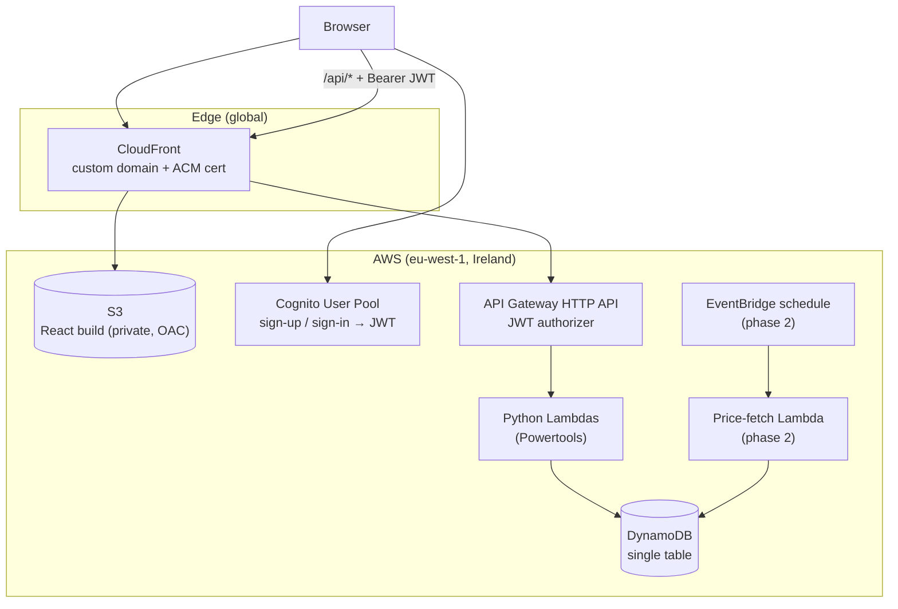

# pensionTracker — Roadmap

This is a living planning document. Edit it directly at any time — add, remove,
reorder, or tick off items — and future work (by you or by Claude) should pick up
your edits automatically by reading this file before starting.

## Overview

A learning project for **AWS serverless** (Python Lambdas) and **infrastructure as
code** (AWS CDK in Python → CloudFormation), built incrementally — one checklist
item at a time, not all at once.

It is also a **portfolio piece**: a real, publicly hosted app that a prospective
employer can sign up to, log in to, and use to track their own pension portfolio.

## Domain & Purpose

**UK Pension Tracker.** Each user tracks their own pensions, in GBP:

- **Pots** — workplace (defined contribution), SIPP, personal pension, and a
  State Pension forecast.
- **Contributions** — money paid in over time, including 25% basic-rate tax
  relief added at source for personal pensions and SIPPs.
- **Valuations** — periodic snapshots of each pot's value, entered manually.
  A pot from any provider can be tracked this way as a single lump-sum value,
  permanently, with no need to break it down into individual investments.
- **Projections** — an interactive growth calculator: take the total (or one
  pot), choose an annual growth rate and a number of years (e.g. 10, or "to
  retirement age"), and see the estimated value. It shows low/mid/high growth
  lines, in future pounds and in today's money, after charges, with optional
  ongoing contributions. An illustration, not a guarantee.
- **Total** — a dashboard headline of all pots' combined value, each pot at its
  latest value with its "as of" date. The State Pension is shown alongside as
  yearly income, not added to the total.

Built in two phases:

1. Pots, contributions and **manual** valuations, with charts and projections.
2. **Instrument-level holdings** — each pot holds units of instruments (funds,
   ETFs, shares, investment trusts), valued from daily prices (manual entry
   first, then a scheduled price-fetch Lambda). Users can see and update how
   many units they hold of each; every update is a dated snapshot, so history is
   kept and charts can show growth over time. Prices may be quoted in other
   currencies (e.g. US shares in USD) but everything is shown in GBP.
   Holdings are **opt-in per pot**: lump-sum (`manual`) pots stay fully
   supported alongside them, and both count towards the total.

This is a demo: users are encouraged to use fictional figures, not real
financial data (see Portfolio polish).

## Architecture

### Request flow (example: list my pots)

1. The browser loads the React app from CloudFront (files live in a private S3
   bucket that only CloudFront can read).
2. The user signs in via Cognito and receives a JWT.
3. The app calls `GET /api/pots` with `Authorization: Bearer <jwt>`. It's the
   same domain as the site: CloudFront routes `/api/*` to the HTTP API
   (caching off, `Authorization` forwarded) and everything else to S3.
4. API Gateway's JWT authorizer verifies the token against the Cognito User Pool
   *before* any Lambda runs — invalid/missing tokens get a 401.
5. The Lambda reads the caller's identity from the verified token's `sub` claim
   (never from the request body/path) and queries DynamoDB for `PK = USER#`.

**Data isolation rule:** a user's ID comes *only* from the verified JWT. Every
DynamoDB key a user can touch is prefixed `USER#`, so one user can never
address another's data.

**Sign-in security.** Sign-in screens are our own React pages (fully branded),
calling Cognito through the Amplify Auth library:

- **The password never crosses the network.** Amplify uses SRP (Secure Remote
  Password): the browser proves it knows the password without sending it, even
  inside HTTPS.
- **No account enumeration.** `PreventUserExistenceErrors` is on, so "wrong
  password" and "no such user" look identical and nobody can probe which emails
  have accounts.
- **Brute force** is slowed by Cognito's built-in lockout with growing delays.
  Email verification is required before first sign-in; passwords need 12+
  characters.
- **MFA (TOTP app) and passkeys** (Face ID / Touch ID / Windows Hello) are
  offered to every user and encouraged after sign-up. Both are included in
  Cognito's free Essentials tier (10,000 MAU). MFA is *optional* at pool level,
  not required: Cognito's MFA setting is pool-wide, and requiring it would block
  the one-click demo accounts (see below), which hold only fictional data.
- **Tokens:** short-lived access/ID tokens (1 hour); refresh tokens revoked on
  sign-out. A strict Content-Security-Policy is the main defence against XSS
  stealing tokens from the browser.
- **Security headers** on every response via a CloudFront response headers
  policy: CSP, HSTS, `frame-ancestors 'none'` / `X-Frame-Options: DENY` (stops
  the sign-in page being framed for clickjacking), `X-Content-Type-Options`,
  `Referrer-Policy`.
- Not enabled (paid, per MAU): Cognito Plus tier's compromised-password checks
  and adaptive risk detection. Noted as an option, not needed for a demo.

**Demo accounts for visitors (e.g. employers).** The landing page has a "Try
the demo (no sign-up)" button. `POST /demo` creates a fresh, private Cognito
user (random username + password, pre-verified, in a `demo` group), seeds it
from a template data set, and returns the credentials to the browser, which
signs in straight away. So each visitor gets their own copy: nobody sees anyone
else's changes, every visitor starts from the same showcase data, and there are
no shared credentials to leak, expire or reset. A banner explains that changes
reset after 24 hours. Demo data carries a DynamoDB TTL (free, automatic
deletion); a scheduled Lambda deletes expired demo users from Cognito.
`POST /demo` is throttled (per-IP counter, cap on concurrently active demo users)
and demo users get tighter limits on anything that costs money.

## Data model (single-table DynamoDB)

| PK | SK | Item |
|---|---|---|
| `USER#` | `PROFILE` | name, date of birth, target retirement age |
| `USER#` | `POT#<id>` | pot name, type, provider, valuation method (`manual` / `holdings`) |
| `USER#` | `POT#<id>#VAL#<date>` | valuation |
| `USER#` | `POT#<id>#CON#<date>` | contribution (gross / net / tax relief) |
| `USER#` | `INST#<instId>` | *(phase 2)* instrument details: name, type (fund / ETF / share / trust), quote currency, provider, ISIN/SEDOL if any |
| `USER#` | `POT#<id>#HOLD#<instId>#<date>` | *(phase 2)* units held as of that date |
| `USER#` | `INSTPRICE#<instId>#<date>` | *(phase 2)* manually entered price, in the quote currency |
| `USER#` | `FXRATE#<ccy>#<date>` | *(phase 2)* manually entered GBP-per-unit exchange rate |
| `INST#<isin>` | `PRICE#<date>` | *(phase 2)* fetched daily price in the quote currency (shared, written only by the price-fetch Lambda) |
| `FX#<ccy>` | `RATE#<date>` | *(phase 2)* fetched daily GBP-per-unit exchange rate (shared, written only by the price-fetch Lambda) |

**Totals are computed on read, never stored.** `GET /summary` sums each pot's
latest value at request time, so the total can't drift out of step with the pots.
Each pot contributes exactly one value, chosen by its valuation method: the
latest manual valuation (`manual`) or latest units × latest price (`holdings`,
phase 2). The State Pension is a forecast of yearly income, not money held, so
it's reported separately and never added to the total. Pots are valued on
different dates, so the summary returns each pot's "as of" date and the UI flags
stale ones rather than implying false precision.

Phase 2 notes:

- **Holdings are dated snapshots, not a single overwritten figure.** Updating
  units means "record units as of <date>"; the latest snapshot is the current
  holding. Units change with every contribution, fund switch and dividend
  reinvestment, so keeping history is what makes value-over-time charts possible
  and separates price growth from new money. Correcting a past snapshot (a typo)
  edits it in place.
- **Instruments, not just funds.** SIPPs hold shares, ETFs and investment
  trusts as well as funds, so the model says *instrument* with a type. `instId`
  is the ISIN when there is one (US shares have them too, e.g. Apple
  `US0378331005`); otherwise (common for workplace pension funds) a generated
  ID, with SEDOL or provider + name stored for display. Instrument details and
  manual prices/rates live in the user's own partition, so one user can never
  alter prices another user sees. Only the price-fetch Lambda writes the shared
  `INST#<isin>` prices and `FX#<ccy>` rates.
- **Prices in their quote currency, converted to GBP on read.** Each
  instrument records its quote currency (`GBP`, `GBX`, `USD`, `EUR`...) and
  prices are stored exactly as quoted. GBP value = units × price × that date's
  GBP rate for the currency. Converting at entry time would throw information
  away and bake in any wrong rate; keeping native prices plus historical rates
  means past values stay correct and fixable. Everything the user sees is GBP.
- **Pence (`GBX`) are a separate currency.** Many London-listed shares, ETFs
  and trusts are quoted in pence, not pounds. Treating pence as pounds makes a
  holding 100× too big, a classic bug, so `GBX` converts at a fixed ÷100 and
  has its own explicit tests.
- **Currency moves are part of growth.** A USD holding gains GBP value when the
  dollar strengthens even if its price is flat. That's real for a GBP investor,
  so it's included in growth (a separate FX breakdown is a stretch item).
- **Exact decimals.** Units (e.g. 1,234.5678) and prices are stored as DynamoDB
  numbers and handled as Python `Decimal`, never `float`, so values don't drift
  through rounding. Money is shown to 2 dp and units to 4 dp.

## Environments & cost

- **dev** and **prod** stacks in a single AWS account, separated by stage name
  (option to split into separate accounts under AWS Organizations later — see
  Stretch).
- **How changes reach production:** laptop → dev → John checks
  `dev.pensiontrackerapp.com` → approves → prod.
  - *Laptop (seconds):* `npm run dev` serves the frontend at
    `http://localhost:5173` with instant reload, talking to the **dev** backend
    (real Cognito and APIs, never prod). Backend logic is tested with
    `uv run pytest` against `moto`'s simulated AWS, with no deploy needed.
  - *dev (AWS):* a complete, separate copy (its own CloudFront site, API,
    Lambdas, DynamoDB table and Cognito user pool), so dev users and data never
    mix with prod and dev can be broken freely. Deployed with
    `cdk deploy --all -c stage=dev`; `cdk watch` (dev only) hot-swaps Lambda
    code in seconds. Once CI/CD exists, every merge to `main` deploys dev.
    Costs pennies at this scale. Sends `X-Robots-Tag: noindex` so search
    engines don't list it; no password on it (fictional data only).
  - *prod:* updated only deliberately: by hand at first, later by approving the
    GitHub Actions deploy job.
- Region **eu-west-1** (Ireland) rather than London: a few percent cheaper
  for most services, gets new features first, and the extra ~10 ms latency from
  the UK is hidden by CloudFront. The CloudFront certificate lives in
  **us-east-1** because CloudFront requires it there.
- Everything chosen to sit within or close to the free tier. Known fixed costs:
  Route 53 hosted zone ~$0.50/month, domain registration (yearly).
- An AWS Budgets alert is part of the infrastructure (emails at 80% actual and
  100% forecast of a small monthly budget).
- dev can be torn down at any time with `cdk destroy`.

### Cost safety

AWS has no hard spending cap and nothing public is attack-proof, so the aim is
a **small, bounded worst case enforced in code**, with the budget as a backstop.
Each public feature that costs money gets a specific limit:

- **No SMS, anywhere.** SMS pumping fraud (bots triggering verification texts to
  premium-rate numbers) is the classic way small apps run up large bills.
  Verification is email only; MFA is TOTP apps or passkeys. Cognito is never
  given an SMS configuration or an SNS role, so it *can't* send texts.
- **Per-IP limit on `POST /demo`** (e.g. 5/hour) so one visitor can't use up
  the day's allowance. HTTP API can't throttle per IP, so the demo Lambda keeps
  a DynamoDB counter per IP (atomic increment, TTL so entries expire). The
  viewer's real IP comes from CloudFront's `CloudFront-Viewer-Address` header:
  behind CloudFront, API Gateway only sees CloudFront's IP. It's stored as a
  salted hash, not the raw IP, to minimise personal data.
- **Daily cap on demo sign-ups** (e.g. 250/day ≈ 7,500/month, under Cognito's
  free 10,000 MAU), enforced with an atomic DynamoDB counter (conditional
  update), plus a cap on concurrently active demo users. Over the cap,
  `POST /demo` returns a friendly "demo busy, try tomorrow".
- **Throttling:** API Gateway route-level rate/burst limits on every route
  (tightest on `POST /demo`), plus **reserved concurrency** on the demo Lambda
  (e.g. 2), which physically limits how fast accounts can be created whatever
  the request rate.
- **AI spend cap (stretch features):** AI off or a tiny allowance for the `demo`
  group; per-user daily limit; and a **global daily token/spend cap** checked in
  code before every Bedrock call.
- **Budget kill switch (backstop):** the budget alert also publishes to SNS,
  which triggers a small Lambda that sets a "cost-sensitive features off" flag
  (SSM parameter). `POST /demo` and AI endpoints check it and refuse while it's
  set; John gets an email and turns them back on manually. Billing data lags by
  hours, which is why this is the backstop, not the first line of defence.
- **CloudFront:** AWS Shield Standard (free, automatic) absorbs network-level
  DDoS. Request floods beyond the free tier cost roughly £10 per 10M requests;
  CloudFront's flat-rate pricing plans (including a $0 tier that throttles
  instead of charging overage) could make this a fixed cost: to evaluate.
- Every limit has a test proving it actually stops requests once reached.

## Interface

- Public website at the custom domain (static hello-world page first, then the
  React app).
- **Frontend stack:** a React + TypeScript single-page app built with Vite,
  served as static files from S3 via CloudFront (no servers, so ~zero cost).
  React because it's the most in-demand frontend skill in UK job adverts;
  Next.js/SSR was rejected because it needs servers or Lambdas to render, and
  only the landing page would benefit (everything else is behind sign-in).
  Supporting libraries:
  - **React Router**: page routes (`/dashboard`, `/pots/:id` …).
  - **Tailwind CSS**: the design system lives in its theme config (brand
    colours, fonts, spacing), so every page, including sign-in, stays on-brand.
  - **TanStack Query**: API data fetching and caching, with loading/error states.
  - **React Hook Form + Zod**: forms and validation; Zod schemas also generate
    the TypeScript types, so rules and types can't drift apart.
  - **Amplify Auth**: Cognito sign-in (SRP). **Recharts**: charts.
  - **Vitest + React Testing Library**: tests that use pages the way a user
    would. **eslint-plugin-jsx-a11y** + contrast checks: accessibility.
- **API: API Gateway HTTP API** at `https://<domain>/api/*`, behind the same
  CloudFront distribution as the site. It verifies Cognito JWTs before any
  Lambda runs, routes each path to its Lambda, throttles per route, and handles
  HTTPS.
  - *HTTP API rather than REST API:* $1.00 vs $3.50 per million requests,
    native JWT authorizer, lower latency. We don't need REST API's extras (API
    keys/usage plans, response caching, direct WAF attachment).
  - *Under CloudFront at `/api/*` rather than `api.<domain>`:* same origin as
    the site, so no CORS configuration and no preflight requests; one domain
    and certificate; and anything added at CloudFront later (WAF, flat-rate
    plan) protects the API too. The `/api/*` behaviour has caching disabled and
    forwards the `Authorization` header and query strings.
  - *Per-IP limits aren't an HTTP API feature* (its throttling is per route),
    and WAF rate-based rules cost ~$6+/month and can't attach to an HTTP API
    anyway. So per-IP limiting (e.g. on `POST /demo`) is done in the Lambda
    with a DynamoDB counter (see Cost safety).
- AWS console + `cdk synth` output to inspect what's deployed.

## Working method

- Work through the checklist **one item at a time**. Finish and verify one before
  starting the next.
- Tick items off as `- [x]` when done; a short note (date, brief detail) is
  optional but helpful.
- This doc is editable — reorder, add, cut, or split items whenever priorities
  change.
- An item isn't done just because it works — it also has to clear the
  **Definition of Done** below before being ticked off.
- Do not commit or push automatically when a task completes — leave changes
  uncommitted so they can be reviewed first. Even when "commit" is mentioned in
  a message that also starts new work, show the diff/summary first.
- Ask before anything that costs money or changes AWS (`cdk deploy`,
  `cdk destroy`, domain purchases).

## Definition of Done

A standing bar every checklist item is measured against:

- **Tests** — ≥90% line coverage for `backend/` and `infra/`
  (pytest-cov `--cov-fail-under=90`, so the test run fails below it); ≥80% for
  `frontend/` (Vitest + React Testing Library). Lambda tests use `moto` for AWS services; infra tests use
  CDK `assertions` against the synthesized templates.
- **Security** —
  - no secrets in git (`.gitignore` covers common patterns; config via CDK
    context, env vars or SSM Parameter Store);
  - secrets & configuration: real secrets (only the phase 2 price API key so
    far) go in **SSM Parameter Store SecureString**, encrypted with the free
    AWS-managed `aws/ssm` key. **Secrets Manager** ($0.40/secret/month) is used
    only for secrets it can rotate automatically (e.g. a database password),
    and a third-party API key can't be rotated that way. Non-secret runtime flags
    (e.g. the budget kill switch) are plain String parameters. Lambdas read
    parameters through Powertools' parameters utility with caching, not on every
    request. Not secrets, so not stored: Cognito pool/client IDs and the API URL
    (public by design; the browser app client has no client secret), demo-user
    passwords (random, single-use, never persisted). No long-lived AWS keys
    anywhere: CI uses GitHub OIDC and Lambdas use their IAM roles (e.g. Bedrock);
  - least-privilege IAM (CDK `grant_*` methods, no wildcard actions/resources);
  - `cdk-nag` (AwsSolutions pack) passes on every synth, and any suppression is
    justified in code;
  - user identity only ever taken from the verified JWT;
  - API error responses never leak stack traces or internal detail;
  - `pip-audit` / `npm audit` clean;
  - S3 buckets private (CloudFront Origin Access Control only); HTTPS only.
- **Data safety** — stateful resources (DynamoDB table, Cognito user pool, S3
  buckets holding user data) are protected against *our* mistakes, the real
  risk, since AWS already stores every DynamoDB write across three AZs:
  - prod: `RemovalPolicy.RETAIN` (survives `cdk destroy` or removal from code)
    and deletion protection where the service supports it; DynamoDB also has
    point-in-time recovery (35 days). dev: `DESTROY`, since it's disposable.
  - **Before any prod deploy, `cdk diff` must show no "replace" on a stateful
    resource.** Some changes (key schema, construct ID) make CloudFormation
    create a new resource and delete the old one, silently wiping its data.
    Tests pin the construct IDs and per-stage protection settings so such a
    change fails CI first.
  - The prod table's key schema is fixed after launch; changes to the data model
    are additive (new item types / attributes), never a key change.
- **Cost** — every new AWS resource is checked against the free tier and its
  cost noted in this plan (Environments & cost). A new AWS *service* is also
  added to [`aws-services.md`](aws-services.md) (what it is, what we use it
  for, cost).
- **Documentation (essential: John learns from this code)** — this project
  exists so John can learn AWS, CDK, Python and React by reading it. Full
  documentation and **verbose comments are a requirement, not a nice-to-have**,
  and the usual "avoid over-commenting" default is deliberately reversed,
  project-wide, in every language (Python, TypeScript/React, CDK, YAML):
  - **Every** module, class and function (public *and* private helpers, React
    components and hooks, CDK constructs) has a docstring/JSDoc saying what it
    does and *why it exists*.
  - Inline comments walk through the reasoning of any non-trivial logic step by
    step: what this line does, why it's done this way, and what would go wrong
    otherwise.
  - **AWS and library concepts are explained where they first appear** (e.g.
    what an Origin Access Control is, why a JWT authorizer runs before the
    Lambda, what a DynamoDB partition key is), with a link to the relevant
    official docs.
  - Notable alternatives are noted where a choice was made ("HTTP API rather
    than REST API because…"), so the trade-off is visible in the code itself.
  - Security- and cost-relevant lines are called out explicitly ("this
    condition is what keeps the bucket private").
  - Tests say in their docstring what behaviour they prove and why it matters.
  - Beyond the code: `docs/how-it-works.md` gets a plain-English walkthrough of
    each feature as it lands; significant decisions are recorded as short
    decision records in `docs/decisions/` (context, options, choice, why);
    `README.md` stays current on how to run, test and deploy.
  - An item isn't done until its documentation is done: missing or thin
    comments are a reason to send it back, just like failing tests.

## Roadmap checklist

### Milestone 1: "Hello world" at a custom domain
- [x] AWS account hardening: root user MFA; IAM Identity Center enabled (eu-west-1) with user `john` + `AdministratorAccess` permission set — documented in `docs/aws-setup.md`
- [x] Local tooling: AWS CLI v2, `uv`, CDK CLI installed; `aws configure sso` profile `pensiontracker` working (`aws sts get-caller-identity`)
- [x] Register the domain in Route 53 (hosted zone auto-created); set `domainName` in `infra/cdk.json`
- [x] Repo scaffolding: `git init`, `.gitignore`, `README.md`, `CLAUDE.md`, this plan, `docs/how-it-works.md`, `docs/aws-setup.md`
- [x] `infra/` CDK Python app: `CertificateStack` (us-east-1, DNS-validated ACM cert), `SiteStack` (private S3 + CloudFront OAC + Route 53 alias records + `BucketDeployment` of `infra/site/`), `BudgetStack` (monthly budget + email alerts); cdk-nag applied; tests ≥90% coverage
- [x] `cdk bootstrap` eu-west-1 + us-east-1; walk through `cdk synth` output; `cdk diff`; `cdk deploy --all`
- [x] Verify: `https://<domain>` and `https://www.<domain>` return the hello page with a valid certificate; `http://` redirects to `https://`; direct S3 access is denied; budget alert subscription email received

### Foundations (backend)
- [x] `backend/` uv project: ruff, mypy, pytest + coverage gate, `moto`
- [x] Split dev vs prod: stage-aware stacks selected with `-c stage=dev|prod` (prod on the apex domain, dev on `dev.<domain>`). **Prod keeps its existing stack names** (`PensionTracker-Certificate`, `PensionTracker-Site`), which already own the live apex/www records: renaming them would make CloudFormation create duplicate records for the same domain. Only dev gets new names (`PensionTracker-Dev-*`). `BudgetStack` is account-wide, so it's deployed once, not per stage. dev responses carry `X-Robots-Tag: noindex`. Tests cover both stages' synthesized names, domains and headers
- [x] Deploy dev (with approval) and confirm `https://dev.pensiontrackerapp.com` serves while prod is unchanged (`cdk diff` on prod shows no changes)

### First Lambda end-to-end
- [ ] `GET /health` Python Lambda behind an HTTP API, routed through CloudFront at `/api/*` (new behaviour in `SiteStack`: caching disabled, `Authorization` + query strings forwarded, viewer IP passed via `CloudFront-Viewer-Address`), deployed to dev — inspect the synthesized template, curl `https://dev.<domain>/api/health`, find its logs in CloudWatch

### Authentication
- [ ] Cognito User Pool + app client in CDK (prod: `RETAIN` + deletion protection; dev: `DESTROY`; construct ID pinned by a test, since replacing the pool wipes every account): email sign-up with required verification, 12+ char password policy, `PreventUserExistenceErrors`, SRP auth flow, 1-hour access/ID tokens, refresh-token revocation, MFA *optional* (TOTP) and passkeys (WebAuthn) enabled; Essentials tier (free to 10,000 MAU)
- [ ] JWT authorizer on the HTTP API; `GET /me` returns the caller's `sub` — verify a request without a token gets 401

### Pots
- [ ] DynamoDB table in CDK, on-demand. prod: `RETAIN` removal policy, deletion protection, point-in-time recovery; dev: `DESTROY`, PITR optional. Tests assert each stage's settings and that the table's construct ID never changes (a changed ID means CloudFormation replaces the table and the data is lost)
- [ ] Restore runbook `docs/runbooks/restore-dynamodb.md`: how to restore from PITR to a new table and switch the app over; practised once on dev so it's known to work before it's ever needed
- [ ] Pots CRUD Lambdas with Powertools (logging, validation, consistent error responses); iterate with `cdk watch` against dev
- [ ] Tests proving user A can never read/modify user B's pots

### Frontend
- [ ] SPA routing in `SiteStack`: CloudFront serves `/index.html` for unknown paths (403/404 → 200 `index.html`) so refreshing `/dashboard` works and React Router shows the right page; test on the synthesized template
- [ ] Vite + React + TypeScript scaffold in `frontend/` with React Router, Tailwind CSS, TanStack Query, React Hook Form + Zod, Vitest + React Testing Library, ESLint (incl. jsx-a11y) and Prettier; replace the hello page with the React build in `SiteStack`; `npm run dev` points at the dev stage's Cognito/API config so local work never touches prod
- [ ] Brand & design system: name/logo, colour palette, typography, shared components (buttons, inputs, cards, form errors), light/dark; a landing page that sets the look for everything after it
- [ ] Security headers via a CloudFront response headers policy (CSP, HSTS, frame-ancestors / X-Frame-Options, nosniff, Referrer-Policy); tests on the synthesized template
- [ ] Branded sign-in pages, our own React components on the Amplify Auth APIs (`signIn` / `signUp` / `confirmSignUp` / `resetPassword` …): sign in, sign up, verify email, forgot password; consistent with the design system; error messages that don't reveal whether an account exists
- [ ] MFA & passkeys: account settings page to enrol a TOTP authenticator app or a passkey; prompt to set one up after sign-up; sign-in handles the MFA/passkey challenge
- [ ] Pots list + create/edit form against the API; creating a pot takes just provider, name, type and a current lump-sum value (valuation method defaults to `manual`)

### Contributions & valuations
- [ ] API endpoints for contributions and valuations
- [ ] UI to record them; chart of value over time per pot and in total (Recharts)

### Dashboard & total
- [ ] `GET /summary`: total of each pot's latest value (computed on read), per-pot value + "as of" date, change since the previous snapshot, State Pension yearly forecast reported separately
- [ ] Dashboard page: headline total, pot list with values and dates, warning for pots not updated in 90+ days, State Pension shown as £/yr from State Pension age

### Projections
Computed in the browser: it's pure compound-growth arithmetic, so sliders
update instantly with no API calls or AWS cost.
- [ ] `projectValue()` pure function in the frontend (start value, growth %, charges %, inflation %, years, monthly contribution incl. basic-rate tax relief where it applies → year-by-year nominal and real values), exhaustively unit-tested with Vitest against hand-worked examples
- [ ] Growth calculator UI: start from the total or a single pot; sliders/inputs for years and growth %; "to retirement age" preset from profile DOB + target retirement age
- [ ] Low / mid / high scenario lines (default 2% / 5% / 8%, editable) on a chart; toggle between future £ and today's money (default inflation 2.5%); charges % (default 0.75%) deducted from growth; optional monthly contribution, defaulting from recent recorded contributions
- [ ] State Pension forecast shown alongside as yearly income from State Pension age
- [ ] Disclaimer on the page: an illustration based on assumed rates, not a guarantee or financial advice
- [ ] Contributions vs growth: split the change in total (and per-pot) value into money paid in versus investment growth, from recorded contributions

### CI/CD (GitHub Actions)
- [ ] GitHub repo; OIDC identity provider + deploy role in CDK (no long-lived AWS keys)
- [ ] `ci.yml` on PRs: ruff, mypy, pytest + coverage, Vitest, `cdk synth` + cdk-nag, `pip-audit`, `npm audit`
- [ ] `deploy.yml`: deploy dev on merge to `main`; deploy prod on manual approval / tag

### Phase 2: instrument holdings
- [ ] Instruments per user: type (fund / ETF / share / trust), quote currency, ISIN where available, otherwise generated ID + SEDOL/name; manual price entry in the quote currency
- [ ] FX: manual GBP-per-unit rate entry per currency and date; GBP conversion on read (units × price × rate); `GBX` (pence) handled as ÷100 with explicit tests; clear error if a needed rate is missing rather than silently using 1
- [ ] Holdings API: add a holding to a pot, record units as of a date (new snapshot), correct or delete a snapshot, list current holdings and a holding's history; units as exact `Decimal`
- [ ] Holdings UI: table per pot (instrument, units, latest price in its quote currency, GBP value, "as of" date) with inline "update units"; history view per holding
- [ ] Pot value computed from latest units × latest price for pots with valuation method `holdings`; value-over-time chart from snapshots; `GET /summary` and the dashboard total use it
- [ ] Provider interface for prices and FX rates (one adapter per data source); API key in SSM Parameter Store (SecureString)
- [ ] Scheduled price-fetch Lambda (EventBridge, daily end-of-day) caching prices and FX rates in DynamoDB — choose a price provider (e.g. Alpha Vantage, EODHD, Twelve Data) after checking UK fund + US share coverage and licensing for display to other users; FX from a free reference source (e.g. ECB daily rates)

### Portfolio polish
- [ ] Template demo data set `backend/demo/seed.json` (fictional): lump-sum workplace pots (one deliberately stale), a SIPP with holdings (UK fund, US share in USD, pence-quoted London ETF), a personal pension, a few years of contributions and valuations, a State Pension forecast. Extend it as features land; also used as test fixtures so CI catches anything that would break the demo
- [ ] `POST /demo` Lambda: create a pre-verified Cognito user in a `demo` group with a random password, seed it from the template, return credentials for the browser to sign in; "Try the demo (no sign-up)" button on the landing page; demo banner ("changes reset after 24 hours")
- [ ] Demo clean-up and abuse limits: DynamoDB TTL on demo data; scheduled Lambda deleting expired demo users from Cognito; API Gateway throttling + per-IP limit on `POST /demo` (DynamoDB counter in the demo Lambda, keyed by a salted hash of the viewer IP so raw IPs aren't stored, with a TTL); cap on concurrently active demo users; tighter limits for the `demo` group on anything that costs money
- [ ] Cost safety (see Environments & cost → Cost safety): daily demo sign-up cap via atomic DynamoDB counter; reserved concurrency on the demo Lambda; route-level throttling on every API route; test asserting the Cognito pool has no SMS configuration; budget kill switch (Budgets → SNS → Lambda → SSM "cost-sensitive features off" flag checked by `POST /demo` and AI endpoints); tests proving each limit rejects requests once reached
- [ ] Architecture diagram + screenshots in the README
- [ ] Privacy note: demo app, don't enter real financial data

### Stretch / later
- [ ] CloudWatch alarms + dashboards; X-Ray tracing
- [ ] AWS WAF on CloudFront / API
- [ ] CloudFront + S3 access logging
- [ ] Evaluate CloudFront flat-rate pricing plans (e.g. the $0 tier that throttles instead of charging overage) to make request-flood cost fixed
- [ ] Cognito Plus tier (compromised-password checks, adaptive risk detection): paid per MAU, only if it ever handles real users
- [ ] GDPR-style data export + account deletion
- [ ] End-to-end tests (Playwright)
- [ ] Separate AWS account for prod (AWS Organizations)
- [ ] Split growth into price growth vs currency (FX) effect for non-GBP holdings
- [ ] Longer-term backups beyond PITR's 35 days: AWS Backup plan or scheduled DynamoDB exports to S3 (check cost first)
- [ ] Transaction-level holdings (buys, sells, switches, dividends) instead of / alongside unit snapshots: more accurate, but much more data entry

### Stretch: fantasy portfolios & AI insights
Not needed for day 1. Both build on phase 2 (instruments, daily prices, FX), so
they come after it.
- [ ] **Fantasy (paper) portfolio:** the user gets virtual cash (e.g. £10,000), picks instruments and amounts, and the portfolio is "bought" at that day's prices; its value is then tracked daily from the price-fetch Lambda's prices, so after e.g. 12 months they can see how it performed. Kept entirely separate from real pots and never counted in the total. Optional backtest mode ("what if I'd bought this a year ago?") using historical prices, if the price provider supplies them.
- [ ] Compare a fantasy portfolio against the user's real pots or a benchmark index over the same period
- [ ] **AI insights (Claude via Amazon Bedrock):** explain a portfolio in plain English: diversification, concentration in one fund/sector/currency, charges, how it compares to a fantasy portfolio. Framed as **education, not advice**: in the UK, personalised investment recommendations are an FCA-regulated activity, so prompts and UI avoid "you should buy/sell X", and every answer carries a disclaimer
- [ ] AI guardrails: only the user's own data is sent (from the verified JWT, like every other endpoint); per-user daily request limit; global daily token/spend cap checked before every Bedrock call; AI off or minimal for the `demo` group; respects the budget kill switch; model output treated as untrusted text (escaped when rendered, never executed or used to write data)

## Current State

- Planning complete. Local tooling installed (AWS CLI v2 in `~/.local/bin`,
  uv, CDK CLI).
- AWS account set up: root MFA, IAM Identity Center (single-Region instance,
  eu-west-1) with user `john` + `AdministratorAccess` (4-hour sessions). The
  `pensiontracker` SSO profile works (`aws sts get-caller-identity` returns the
  `AWSReservedSSO_AdministratorAccess` role). Declined the AWS CLI's offer to
  configure AWS skills / MCP server for AI agents, so AWS actions stay as visible,
  approvable shell commands.
- Domain `pensiontrackerapp.com` registered in Route 53 and verified; set as
  `domainName` in `infra/cdk.json`.
- Repo initialised and pushed to GitHub (public:
  https://github.com/jp5k/pensionTracker), with commits using the GitHub
  noreply email (set in this repo's local git config). Docs scaffolded.
- CDK bootstrapped in eu-west-1 and us-east-1. **All three stacks deployed**:
  `PensionTracker-Certificate` and `PensionTracker-Site` are CREATE_COMPLETE;
  `PensionTracker-Budget` shows UPDATE_ROLLBACK_COMPLETE (healthy). An update
  with a typo'd `alertEmail` was rejected by Budgets and rolled back to the
  original, working budget; the redeploy left it unchanged, so the status stays.
- Cost guardrails: $10/month budget (80% actual, 100% forecast alerts); Free Tier
  alerts and Cost Anomaly Detection (Default-Services-Monitor) set up in the console.
- `alertEmail` is now shape-checked at synth (`EMAIL_PATTERN` in
  `app_builder.py`) so typos fail before deploying; mypy now excludes `cdk.out/`.
  `uv run pytest`: 20 tests pass at 100% coverage; ruff and mypy (strict) clean.
- **Milestone 1 complete.** Verified: `https://pensiontrackerapp.com` and
  `https://www.…` return 200 with a valid ACM certificate (both names in the SAN,
  expires May 2027, auto-renewed by ACM); `http://` returns 301 → `https://`;
  direct S3 URLs return 403; the budget's alerts (80% actual, 100% forecast) go to
  John's email.
- Plan extended (before starting the backend): unit holdings as dated
  snapshots; dashboard total; projections calculator; multi-currency pricing
  (GBX, FX); lump-sum pots; sign-in security, branding and one-click demo
  accounts; cost safety limits and kill switch; secrets policy; dev → prod
  workflow; frontend library choices; API Gateway HTTP API under `/api/*`;
  data safety rules; fantasy portfolios + AI insights (stretch). CLAUDE.md and
  the Definition of Done now make verbose documentation a hard requirement.
- `backend/` uv project created (decision record 0001): Python 3.13, `src/`
  layout so CDK will bundle only runtime code; ruff, mypy (strict), pytest with
  a 90% line + branch coverage gate, pip-audit; moto for faking AWS, plus an
  autouse fixture forcing fake credentials so tests can never reach the real
  account. First code: `responses.json_response` (API Gateway v2 response
  shape, `Cache-Control: no-store`) and the `health` handler (written and
  tested, deployed in "First Lambda end-to-end"). 9 tests, 100% coverage; all
  checks clean. `docs/decisions/` started (README + template + 0001).
- `docs/aws-services.md` added: every AWS service, what it's for, status and cost.
- **Dev/prod split done (code only, nothing deployed; decision record 0002).**
  `-c stage=dev|prod` is required on every `cdk` command (no default; unknown
  values rejected). Per-stage differences live in `infra/.../stages.py`. Prod
  keeps its original stack names and construct IDs (tests pin the exact
  deployed logical IDs); dev is `PensionTracker-Dev-Certificate` /
  `PensionTracker-Dev-Site` on `dev.<domain>` with `X-Robots-Tag: noindex`
  (custom headers policy repeating the managed security headers). The budget is
  prod-only, so dev needs no `alertEmail`. Fixtures build both stages; shared
  security tests run against each. infra: 49 tests, 100% coverage, ruff + mypy
  clean. Verified: `cdk diff -c stage=prod` shows **no differences** in all
  three live stacks; `cdk diff -c stage=dev` shows only the two new stacks.
  README deploy section, `aws-setup.md` step 6 (bootstrap now uses
  `-c stage=dev`) and `how-it-works.md` updated. Committed (28afd54).
- **Dev deployed** (John ran `cdk deploy --all -c stage=dev`).
  `PensionTracker-Dev-Certificate` (us-east-1) and `PensionTracker-Dev-Site`
  (eu-west-1) are CREATE_COMPLETE. Verified: `https://dev.pensiontrackerapp.com`
  returns 200 with a valid ACM certificate (CN/SAN `dev.pensiontrackerapp.com`,
  expires May 2027, auto-renewed) and `X-Robots-Tag: noindex` alongside the
  security headers; `http://` returns 301 → `https://`; the dev bucket's direct
  S3 URL returns 403. Prod unchanged: apex and `www` still return 200 and
  `cdk diff -c stage=prod` shows no differences in all three stacks.
- **Next:** First Lambda end-to-end: `GET /health` behind an HTTP API, routed
  through CloudFront at `/api/*`, deployed to dev.

## How to update this plan

- Edit this file directly whenever priorities, scope, or decisions change.
- Claude should re-read this file at the start of a session, work on the next
  unticked checklist item (not several at once unless asked), and update
  **Current State** as items land.
- Tick items off `[x]` as they're completed; let git history hold the detail.
